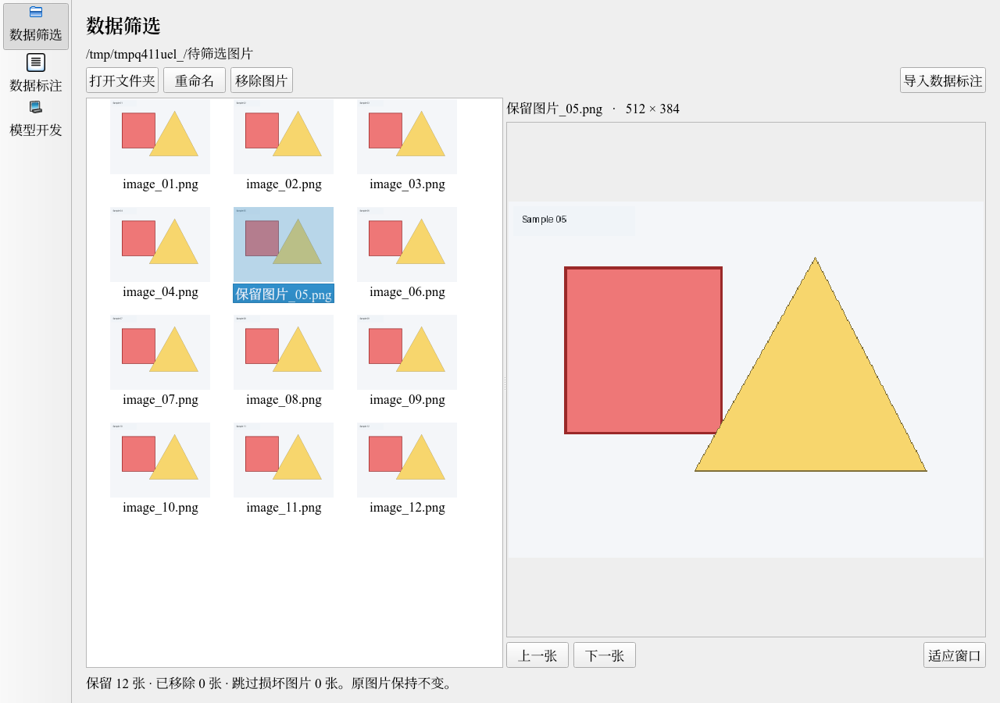
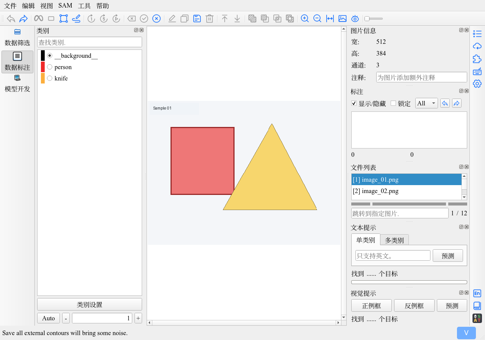

# 数据筛选验证（2026-10-30）

原生 PyQt5 页面已接入 YOLO-BACKPROP，左侧三个入口为数据筛选、数据标注、模型开发。没有重建标注画布。

1. 拖入一个本地图片目录，递归读取普通图片并显示缩略图、大图；支持多选移除、F2 重命名、上一张/下一张、滚轮缩放和适应窗口。
2. 移除和重命名仅作用于本轮筛选。导入时选择保存位置，生成新项目 `images/` 与 `json/`，自动打开原 ISAT。无标注图片不预生成空 JSON；保存标注后写到 `json/`。
3. 自动区分重复文件名和重复 stem；重命名冲突拒绝覆盖。源文件变化、无法复制、取消时清理临时输出，不发布未完成项目。
4. 保留有效同名 ISAT 标注，更新输出文件名。未保存标注取消切换时保留原画布，已生成的项目可再次点击导入打开。SAM 加载、编码或传播期间不替换当前数据集。

实际 Qt 界面截图使用程序生成的测试图片，并非用户数据：

命令：`QT_QPA_PLATFORM=offscreen PYTHONPATH="$PWD/.runtime/python:$PWD" /home/ljz/miniconda3/envs/isat_env/bin/python -m unittest discover -s tests -v`。

结果：42 项通过，11.008 秒。新增测试覆盖筛选记录、真实 Qt 拖放、后台预览、选择移除/重命名、项目导入及真实 JSON 保存；既有训练/推理/导出、画布恢复和 GPU/SAM 守卫测试保持通过。新增功能不改变模型算法，本轮未重复训练或 GPU 验证。测试详情见 `tests.log`。

源码启动检查：`QT_QPA_PLATFORM=offscreen timeout 7 ./run-isat.sh`，GUI 正常进入事件循环，7 秒后由验证超时停止（124），无异常栈或 Qt 插件加载失败。见 `startup.log`。这是离屏自动检查；未代替用户的鼠标实际操作检查。

单代理自审：检查了原图字节保持、复制失败与取消、文件名冲突、异步结果、页面快捷键、三页互切和后台关闭清理；额外复现并修正了复制中途源文件变化，以及取消后迟到扫描结果启动预览的问题。用户配置语言在开发期间从 en 变为 zh，保留该设置；之后验证过程中该文件哈希保持不变。
