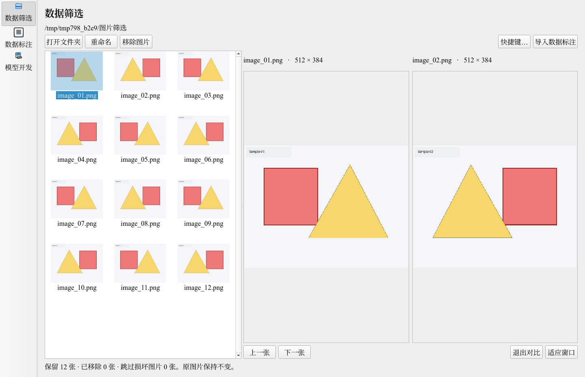
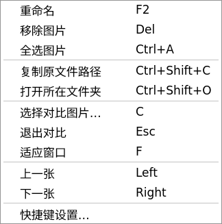
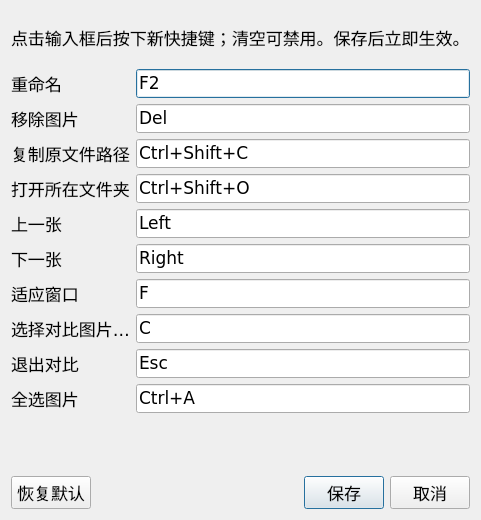

# 筛选浏览增强验证（2026-10-30）

用户确认的右键菜单、可修改保存的快捷键、拖动双图对比、默认三列已接入原生筛选页。

- 当前主图保持，拖入另一张图后右侧等分为两张；两图独立缩放、平移，适应窗口作用于两张，默认 Esc 退出。拖动前记录主图，避免鼠标选择拖拽目标时把原主图丢掉。
- 左栏按可用宽度调整单元格，固定三列，包含竖滚动条时也不变四列。测试覆盖宽、窄两种左栏。
- 共用 QAction 驱动右键、按钮与快捷键，菜单随配置自动更新。右上角“快捷键…”可编辑、清空、恢复默认；保存立即生效并写入用户目录 `~/.config/yolo-backprop/screening-shortcuts.json`（支持 XDG_CONFIG_HOME）。取消不更新；冲突、非法键和多段键序列不覆盖原配置。软件主配置不改动。
- 原图、筛选副本、项目导入与标注保存语义保持不变。文件夹拖放和图片对比均声明 CopyAction，不请求移动或删除源文件。

实际 Qt 界面截图使用测试图片：







验证命令：

```bash
QT_QPA_PLATFORM=offscreen PYTHONPATH="$PWD/.runtime/python:$PWD" /home/ljz/miniconda3/envs/isat_env/bin/python -m unittest discover -s tests -v
```

结果：53 项通过，12.277 秒，详情 `tests.log`。覆盖拖放事件、拖前主图保留、两个预览宽度（截图实测 408/407 像素）、关闭和快速替换对比图时丢弃旧读取结果、宽窄左栏三列、真实按键重映射、复制路径、配置保存重载/冲突/取消与工作区快捷键隔离。测试设置均在临时目录，当前 `ISAT/software.yaml` 哈希保持 `a538c2368fe057a70b13bb61b709bf0cd94ce31f6a0b3dca39a9179ee7ba7fa0`。

单代理自审：检查 Qt 拖拽选择顺序、复制语义、预览线程生命周期、共享菜单动作、快捷键保存原子性和模态设置窗口；未发现未处理的阻断问题。原生截图与事件测试在 offscreen 平台运行，没有替用户执行真实桌面鼠标拖拽；外部文件管理器仅在用户触发菜单时打开。本轮不更改模型功能，也未重复 GPU 或训练测试。
